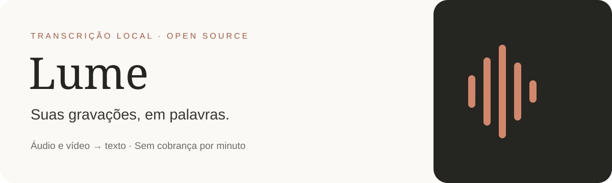

  
  
  

O **Lume** transforma vídeos e áudios em texto no seu computador, usando Whisper. Arraste uma gravação, escolha a qualidade e transcreva. Sem assinatura, cobrança por minuto ou envio da mídia para serviços externos.

## Baixar e usar

**[Baixar a versão mais recente →](https://github.com/Davibzf/Lume/releases/latest)**

1. Baixe **Lume-Setup.exe** nos anexos da release e execute.
2. Clique em **Instalar** e abra **Lume** pelo atalho criado.
3. Arraste um áudio ou vídeo para a janela, ou clique em **Abrir vídeo ou áudio**.
4. Escolha idioma e qualidade e clique em **Transcrever**. No primeiro uso, o Lume baixa e verifica o modelo automaticamente.
5. Revise o resultado e exporte **TXT**, **SRT** ou **VTT**.

Não é necessário instalar Python, FFmpeg ou drivers de GPU. O instalador inclui o aplicativo e os motores. A primeira transcrição precisa de internet para baixar o modelo; depois funciona offline.

Também há um **MSI** para instalação direta e um **ZIP portátil**: extraia tudo e abra `TranscreveLocal.exe`, mantendo a pasta `_internal` ao lado. Esse nome interno preserva compatibilidade com as versões anteriores.

## O que ele faz

- Transcrição local por CPU, com modos **Turbo** e **Máxima qualidade**.
- Arrastar e soltar um áudio/vídeo por vez, incluindo nomes com espaços e acentos.
- Português, inglês, espanhol e detecção automática de idioma.
- Progresso informado pelo motor e cancelamento da operação.
- Editor para revisão, cópia e exportação de texto e legendas.
- Instalação por usuário e desinstalação que preserva modelos e arquivos exportados.

As edições no editor são exportadas em TXT. SRT/VTT preservam o texto e os tempos originais do motor. O Lume não identifica os participantes automaticamente. Revise sempre o resultado, especialmente nomes próprios, música e fala sobreposta.

## Compatibilidade

| Item | Suporte |
|---|---|
| Sistema | Windows 10/11 de 64 bits |
| Processador | Intel/AMD x64, com seleção de backend de CPU pelo Whisper |
| Memória | 8 GB recomendados para Turbo; 16 GB para maior conforto |
| GPU | Não é necessária; esta distribuição usa CPU |
| Armazenamento | Aplicativo, cerca de 600 MB–1,1 GB por modelo e espaço temporário para o áudio |
| Windows ARM64 | Não validado; pode depender da emulação x64 |
| Windows 32 bits, macOS e Linux | Sem executável oficial nesta versão |

Um EXE de Windows não funciona em todos os sistemas. O suporte anunciado é o da tabela; o desempenho varia com o computador e a duração da gravação.

## Qualidade e modelos

| Modo | Modelo | Download aproximado |
|---|---|---|
| Turbo | large-v3-turbo quantizado | 574 MB |
| Máxima qualidade | large-v3 quantizado | 1,08 GB |

Os modelos ficam em `%LOCALAPPDATA%\TranscreveLocal\models` e são reutilizados após atualizações. É possível baixar o modelo antes pelo botão **Baixar modelo**.

## Privacidade e remoção

A mídia é processada localmente. Não há telemetria nem upload de gravações. Apenas o modelo público é baixado do Hugging Face, com verificação de integridade. Os arquivos originais não são modificados.

Para remover, use **Desinstalar Lume** no menu Iniciar ou Aplicativos instalados do Windows. Modelos baixados, mídias originais e transcrições exportadas permanecem no computador. Salve o texto do editor antes de fechar.

## Projeto e contribuição

- [Compilar e gerar instaladores](docs/BUILD.md)
- [Contribuir](CONTRIBUTING.md) · [Reportar problemas](https://github.com/Davibzf/Lume/issues)
- [Segurança](SECURITY.md) · [Componentes e licenças](THIRD_PARTY_NOTICES.md)
- [Histórico de versões](CHANGELOG.md)

O código do Lume está sob a [licença MIT](LICENSE). Whisper, Python, Tcl/Tk, FFmpeg e outros componentes conservam suas próprias licenças. Os fontes correspondentes do FFmpeg distribuído acompanham as releases.
